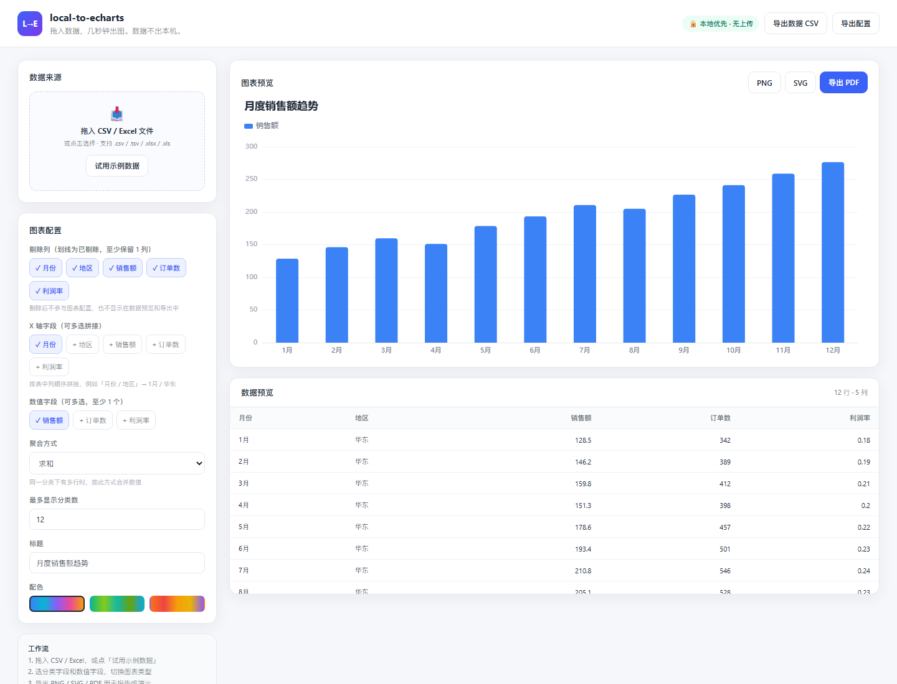

# local-to-echarts

**A local-first charting tool: drop in a CSV/Excel file, configure a chart in a few clicks, export PNG/SVG/PDF. Your data never leaves the machine.**

> Status: **v0.1 MVP is runnable**. Browser preview and desktop app share one Vue codebase; the desktop shell is Electron, so no Rust is involved anywhere.



## Why

RAWGraphs, DataEase and GoView are web apps; MadY and DataAnalyzerApp are Python/Qt with a dated UI; Data Formulator requires an LLM API key. This project fills the gap: an offline-capable desktop tool with a modern Vue 3 + ECharts interface. The desktop shell is Electron — all product logic is front-end JS, and the main process is just a few lines that create a window, so you never have to touch Rust.

## Features

- Drag & drop `.csv`, `.tsv`, `.txt`, `.xlsx`, `.xls`; auto-detects delimiters, BOM, quoted fields and numeric columns, with merged / two-level Excel headers joined into unique names
- Table preview with deduplicated headers and right-aligned numbers
- Bar / line / pie charts with multi-field X axis joining (e.g. `Month / Region` → `Jan / East`, custom separator), multiple value series and six aggregation modes
- Stack by field: split a field's values into series while X stays on another field (e.g. X=时段, stack=结算日期 puts multiple dates on one tick); select participating values individually or use Select all / Reset-to-default, with no nested scrollbar (the sidebar scrolls once), and toggle cumulative stacking
- Row exclusion: untick unwanted rows in the preview table; excluded rows are skipped in charts and exports but remain visible (marked) so they can be restored
- Title, palette and category limit controls; options are grouped into collapsible Basic / Stack / Appearance sections so the sidebar stays short
- Three view modes: switch between Chart, Split and Data from the toolbar — chart-only, table-only, or both stacked. The page itself never scrolls; only the sidebar and the active panes scroll, so the chart stays put
- Export to PNG (2x), SVG, PDF, plus raw CSV and full-config JSON
- No uploads, no telemetry, no network calls at runtime

## Quick start

### Browser preview (fastest)

Node.js 20.19+ or 22.12+ required (Vite 8 minimum; verified on Node 22.22):

```bash
npm install
npm run dev
```

Open <http://localhost:1420>. Sample data loads automatically so a chart is visible immediately.

> The `xlsx` dependency points to [SheetJS official CDN 0.20.3](https://cdn.sheetjs.com/xlsx-0.20.3/xlsx-0.20.3.tgz), not the npm registry package stuck at 0.18.5 (which has known security issues). This is the installation method recommended by SheetJS.

```bash
npm run build   # static output in dist/
```

### Electron desktop app

No Rust, WebView2 or MSVC needed. `npm install` downloads the Electron binary; if the network is restricted, set a mirror before reinstalling.

```bash
npm run dev:electron   # one command: Vite on port 1422 + desktop window
npm run electron       # open the desktop window alone (needs npm run dev on 1420)
npm run dist           # package with electron-builder; output in release/
```

`dev:electron` uses port 1422 so it never conflicts with the browser preview on 1420 — both can run at once.

## Architecture

| Layer | Stack | Notes |
|---|---|---|
| UI | Vue 3.5 + Vite 8 | Composition API, no UI kit |
| Charts | ECharts 6 | Options built in `src/utils/chart.js` |
| Excel | SheetJS 0.20.3 (official CDN) | Reads the first worksheet in-browser |
| PDF | jsPDF 4 | Dynamically imported |
| Desktop shell | Electron 45 | Main process `electron/main.cjs` only creates the window; all product logic is in the renderer |

The main process owns windows and OS integration; business code never needs to know about it. Future native features can use Electron's `dialog` / `ipcMain` APIs (still Node JS), or keep using browser downloads.

## Privacy

Parsing, aggregation and rendering all happen in the renderer process. There is no backend; `electron/main.cjs` disables `nodeIntegration`, enables `contextIsolation`, so the renderer has no Node API access, and external links are handed to the system browser. The only network activity is `npm install` when you fetch dev dependencies.

## Roadmap

- [x] CSV/TSV/Excel import and table preview
- [x] Bar/line/pie charts, field mapping, aggregation
- [x] PNG/SVG/PDF/CSV/JSON export
- [ ] Native save dialog (Electron dialog + ipcMain)
- [ ] Save/load chart config presets
- [ ] Group-by series
- [ ] Dark theme
- [ ] Tree-shake ECharts to shrink the installer
- [ ] macOS/Linux packaging checks

## Contributing

Fork, create a `feat/xxx` branch, commit, open a pull request. Please run `npm run build` before submitting.

## License

[MIT](LICENSE) © 2026 zengjianjin0920
