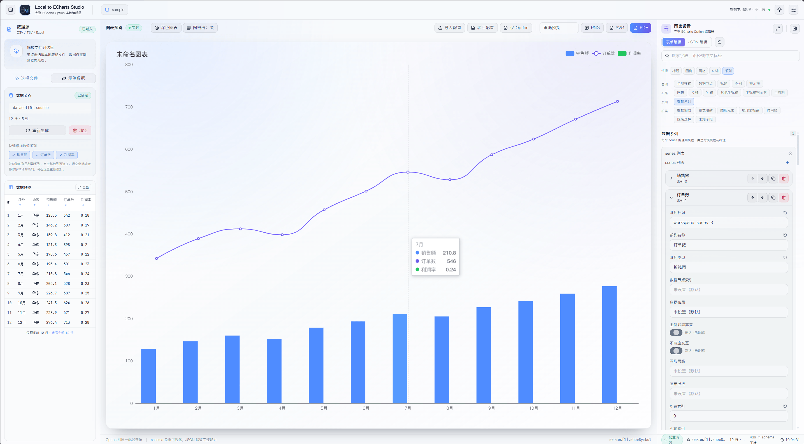
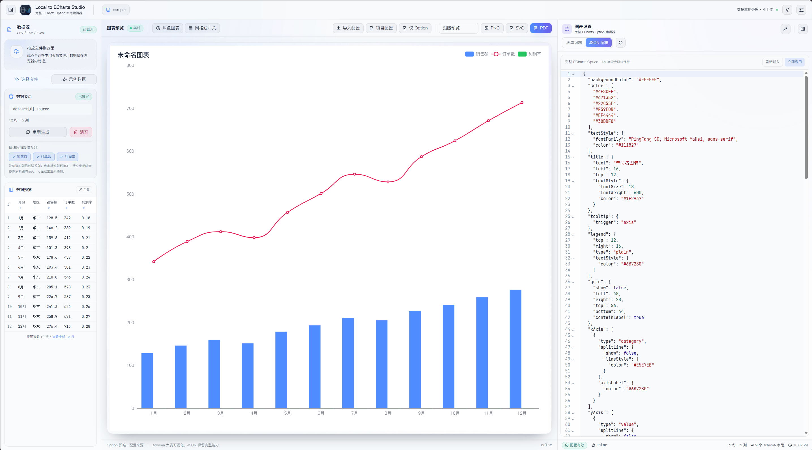
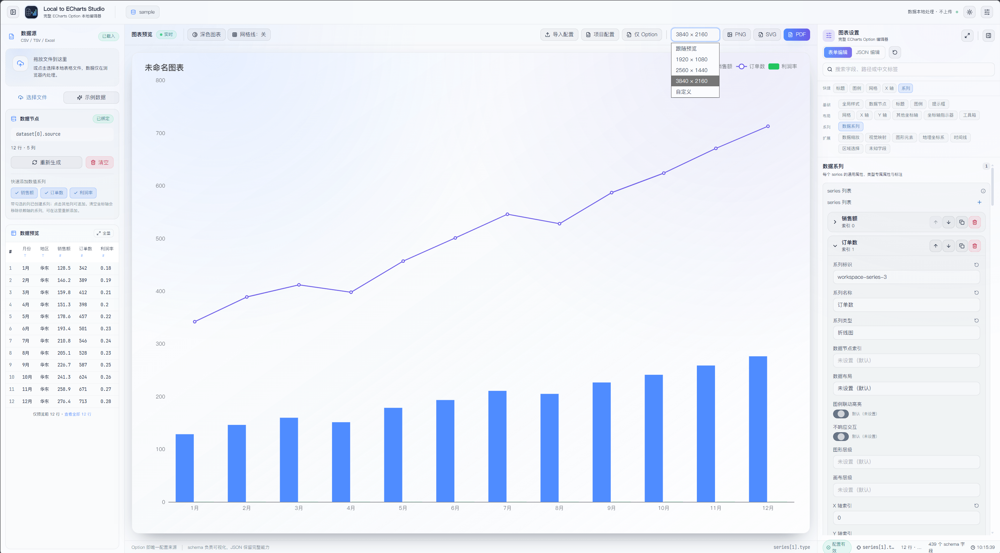
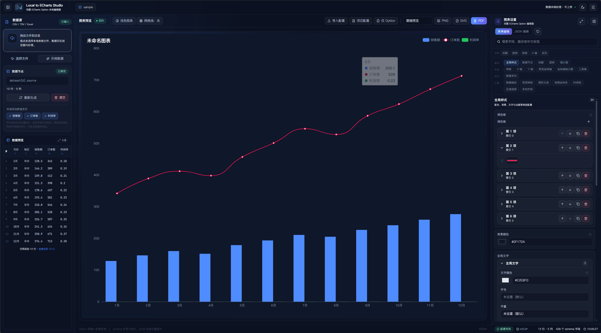

# Local to ECharts Studio

**[Live demo](https://zengjianjin.github.io/local-to-echart/)** · [中文版](README.zh-CN.md) · [MIT License](LICENSE)

> **Local-first ECharts Studio — your data never leaves your machine, and what you export is a standard, reusable ECharts option.**
>
> Import CSV / TSV / Excel, edit every ECharts field visually or as JSON, then export charts or the option itself.

## Screenshots

**Three-panel workbench — import, preview, and edit in one place**



**JSON mode — edit the complete ECharts option with a live preview**



**Export PNG / SVG / PDF at the resolution you need**



**Light and dark themes**



A local-first workbench for turning tabular data into ECharts charts. The right panel is a full option inspector: schema-driven visual forms for everyday editing plus a JSON editor for every ECharts field, including unknown and future fields.

## Features

- Import CSV, TSV, and Excel files entirely in the browser process.
- Preview headers, inferred field types, and the first 12 rows, with a full-data dialog for every row.
- Write imported tables into standard ECharts `dataset.source`; map fields with `series.encode`.
- Edit the complete ECharts option through categorized visual forms or JSON.
- Add, duplicate, reorder, and remove arrays such as `series`, `xAxis`, `dataZoom`, and `graphic`.
- Preserve unknown fields when switching between form and JSON modes.
- Convert safe formatter templates into runtime callbacks without executing arbitrary code.
- Export PNG, SVG, PDF, and JSON project files with selectable export resolution.
- Keep form, JSON, and rendered chart in sync; unset fields are never replaced with fabricated defaults.
- Switch between light (default) and dark UI themes; image exports use the option's `backgroundColor` (white by default).
- Run in a browser or as an Electron desktop app.

## Why Local to ECharts Studio

| | Local to ECharts Studio | RAWGraphs | Typical paste-and-chart sites |
|---|---|---|---|
| Where data is processed | Entirely in your browser / desktop app; no upload | Browser-based | Often uploaded to a server |
| What you get out | A full, serializable **standard ECharts `option`**, plus PNG / SVG / PDF | Publication-ready SVG / PNG | An image or a hosted chart link |
| Reuse in your own code | Paste the option into any ECharts project | Not an ECharts option | Usually limited to re-uploading data |
| Editing depth | Visual forms **and** a JSON editor for every field, including unknown ones | Curated chart types and mappings | Preset options only |
| Offline desktop app | Yes (Electron) | No | No |

If you only need a chart **image**, RAWGraphs is excellent. If you need the **ECharts option** that produced the chart — to ship it in a dashboard, keep tweaking it in code, or version it in Git — this is the tool for you.

## Architecture

The application has no legacy configuration layer. A single serializable ECharts option is the source of truth.

```text
Imported file -> TableData -> dataset.source -> runtime option -> ECharts
Right panel   -> schema paths / JSON draft -> option -> preview
```

## Development

```bash
pnpm install
pnpm dev
pnpm typecheck
pnpm build
pnpm dev:electron
pnpm dist
```

Browser dev server: `http://localhost:1420`. Electron dev mode uses port `1422` and passes it through `VLE_DEV_URL`. `pnpm dist` produces an installer in `release/` via electron-builder.

## Configuration format

Project files use `formatVersion: 1` and contain `meta`, `option`, and an optional `table`. Older configuration formats are intentionally rejected; there is no migration or compatibility branch.

## Documentation

- [Getting started](docs/getting-started.md) (Chinese): install, import, edit, export, and theme switching.
- [Option editor](docs/option-editor.md): form/JSON modes and field types.
- [Data binding](docs/data-binding.md): CSV/TSV/Excel parsing and `dataset` / `encode` mapping.
- [Architecture](docs/architecture.md): state model and runtime data flow.
- [QA checklist](docs/qa-checklist.md): feature verification list.

Example files: `examples/sample.csv` and `examples/sample-chart-project.json`.

## Notes

- The full ECharts bundle is used so advanced components such as `dataZoom`, `visualMap`, `toolbox`, and `graphic` work without manual registration.
- Formatter callbacks are represented as serializable template descriptors. Arbitrary JavaScript strings are never evaluated.
- Electron keeps `nodeIntegration` disabled and `contextIsolation` enabled.

## License

[MIT](LICENSE) © 2026 zengjianjin0920
