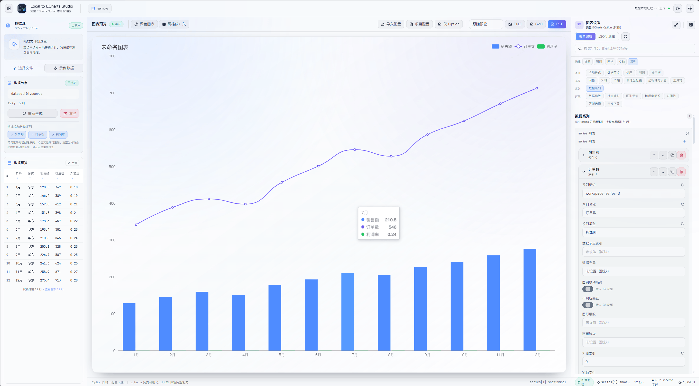
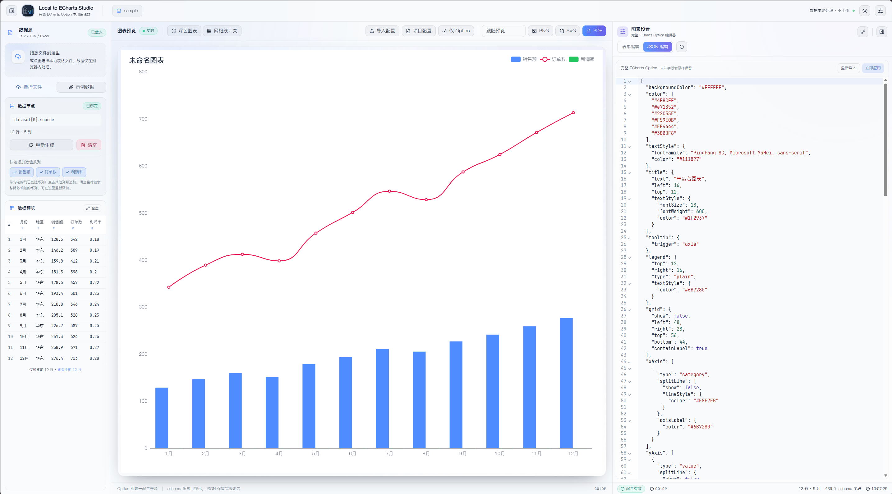
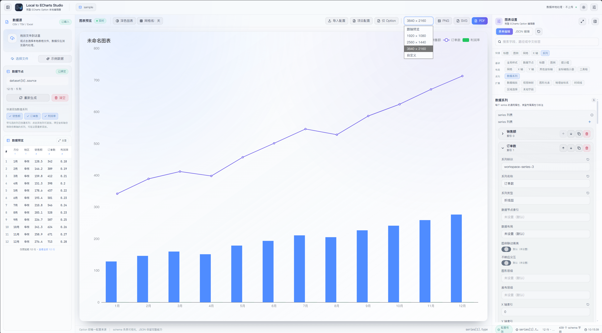
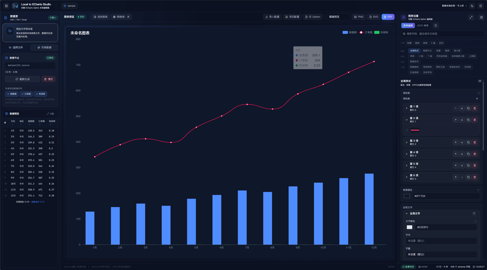

# Local to ECharts Studio

**[在线 Demo](https://zengjianjin.github.io/local-to-echart/)** · [English](README.md) · [MIT 许可证](LICENSE)

> **本地优先的 ECharts Studio——数据不出本机，导出的是可直接复用的标准 ECharts option。**
>
> 导入 CSV / TSV / Excel，用表单或 JSON 编辑任意 ECharts 字段，再导出图表或 option 本身。

## 界面预览

**三栏工作台：数据导入、实时预览、属性编辑一屏完成**



**JSON 模式：直接编辑完整 ECharts option，右侧实时预览**



**导出 PNG / SVG / PDF，可自定义分辨率**



**浅色与深色主题**



一个本地优先的数据到图表工作台。左侧导入并预览表格数据，中间实时渲染 ECharts 图表，右侧提供完整的属性检查器：默认使用 schema 驱动的可视化表单，也可切换到 JSON 直接编辑任意 ECharts 字段。

## 核心能力

- 在浏览器进程内解析 CSV、TSV 与 Excel 文件，数据不上传。
- 速览表头、字段类型与前 12 行数据，并可打开全量预览弹窗查看所有行。
- 将表格写入标准 ECharts `dataset.source`，通过 `series.encode` 完成字段映射。
- 可视化编辑完整 option 的已知字段，JSON 模式编辑所有字段与未知字段。
- 支持 `series`、`xAxis`、`dataZoom`、`graphic` 等数组项的新增、复制、排序和删除。
- 表单与 JSON 双向同步，未知字段不会被表单清理。
- 使用可序列化的模板描述表达 `formatter`，不执行任意 JavaScript。
- 导出 PNG、SVG、PDF 与 JSON 项目文件，支持自定义导出分辨率。
- 表单、JSON 与渲染使用同一份配置；表单不会伪造 option 中未设置的默认值。
- 浅色（默认）与深色主题切换；图片导出使用 option 中的 `backgroundColor`（默认白底），不受界面主题影响。
- 支持浏览器和 Electron 桌面运行。

## 为什么选择本项目

| | Local to ECharts Studio | RAWGraphs | 常见粘贴出图网站 |
|---|---|---|---|
| 数据处理位置 | 完全在浏览器 / 桌面应用内，不上传 | 浏览器内处理 | 通常需要上传到服务器 |
| 产出物 | 完整可序列化的**标准 ECharts `option`**，以及 PNG / SVG / PDF | 适合发布的 SVG / PNG | 图片或托管图表链接 |
| 在自己代码中复用 | 把 option 贴进任意 ECharts 项目即可 | 不是 ECharts option | 通常只能重新上传数据 |
| 编辑深度 | 可视化表单 **+** 覆盖所有字段（含未知字段）的 JSON 编辑器 | 预设图表类型与字段映射 | 只有预设选项 |
| 离线桌面版 | 有（Electron） | 无 | 无 |

如果你只要一张图表**图片**，RAWGraphs 很好用；如果你要的是生成这张图的 **ECharts option**——能放进仪表盘、能在代码里继续改、能提交进 Git——那这个工具更适合你。

## 架构

项目不保留任何旧配置层。可序列化的完整 ECharts option 是唯一配置来源。

```text
导入文件 -> TableData -> dataset.source -> 运行时 option -> ECharts
右侧编辑 -> 路径写入 / JSON 草稿 -> option -> 实时预览
```

## 开发

```bash
pnpm install
pnpm dev
pnpm typecheck
pnpm build
pnpm dev:electron
pnpm dist
pnpm dist:win
```

浏览器开发端口为 `1420`；Electron 开发模式使用 `1422`，并通过 `VLE_DEV_URL` 传给主进程。`pnpm dist` 使用 electron-builder 在 `release/` 目录生成安装包；`pnpm dist:win` 一键生成 Windows NSIS 安装包（`*.exe`）。首次打包需要下载 Electron 与 NSIS 资源，脚本默认使用 npmmirror 镜像，也支持通过 `ELECTRON_MIRROR` / `ELECTRON_BUILDER_BINARIES_MIRROR` 覆盖。Windows 构建设置了 `signAndEditExecutable: false`，跳过 exe 资源编辑，因此不需要管理员权限或开发者模式来解压 winCodeSign；只有需要自定义图标或代码签名时才应改回。NSIS 安装时可选择安装目录，打包内容只包含构建产物，不含 `node_modules`，并只保留 `en-US` 和 `zh-CN` 两种 Electron 语言包。

## 配置格式

项目文件使用 `formatVersion: 1`，包含 `meta`、`option` 和可选的 `table`。旧配置格式会被明确拒绝，项目不提供兼容或迁移分支。

## 文档

- [使用指南](docs/getting-started.md)：安装启动、数据导入、界面操作、导出与主题切换的完整入门流程。
- [全属性编辑器](docs/option-editor.md)：表单/JSON 双模式与字段类型说明。
- [数据绑定](docs/data-binding.md)：CSV/TSV/Excel 解析与 `dataset` / `encode` 映射。
- [架构](docs/architecture.md)：状态模型与运行时数据流。
- [验收清单](docs/qa-checklist.md)：功能验收与回归项。

示例文件：`examples/sample.csv`、`examples/sample-chart-project.json`。

## 说明

- 项目使用全量 ECharts，确保 `dataZoom`、`visualMap`、`toolbox`、`graphic` 等高级组件无需手动注册即可使用。
- 函数型字段使用模板描述对象表达，不会执行用户输入的脚本。
- Electron 保持 `nodeIntegration` 关闭、`contextIsolation` 开启。

## 许可证

[MIT](LICENSE) © 2026 zengjianjin0920
